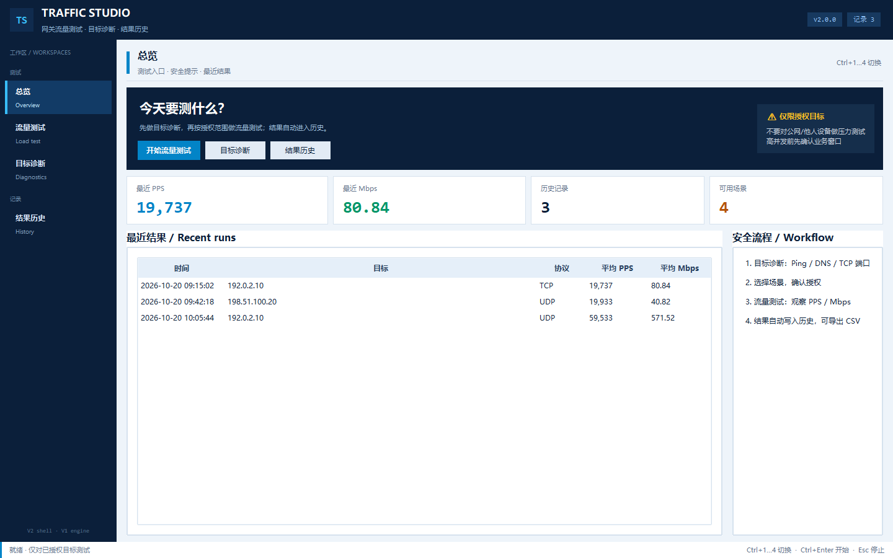
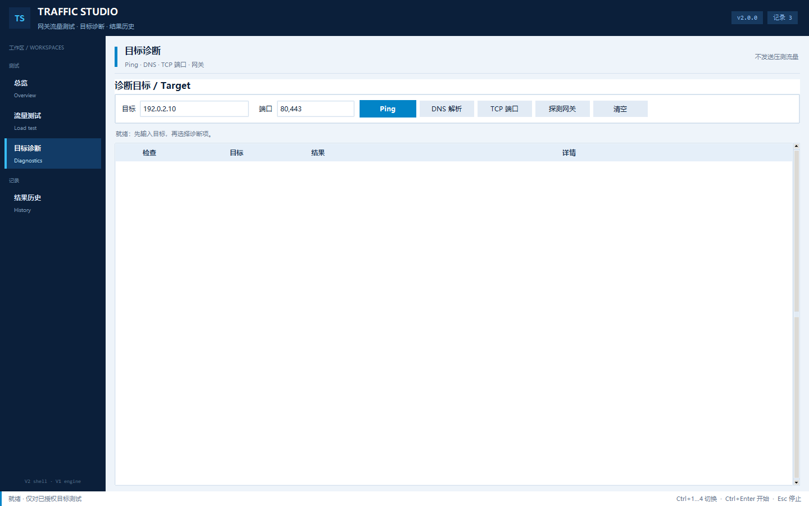
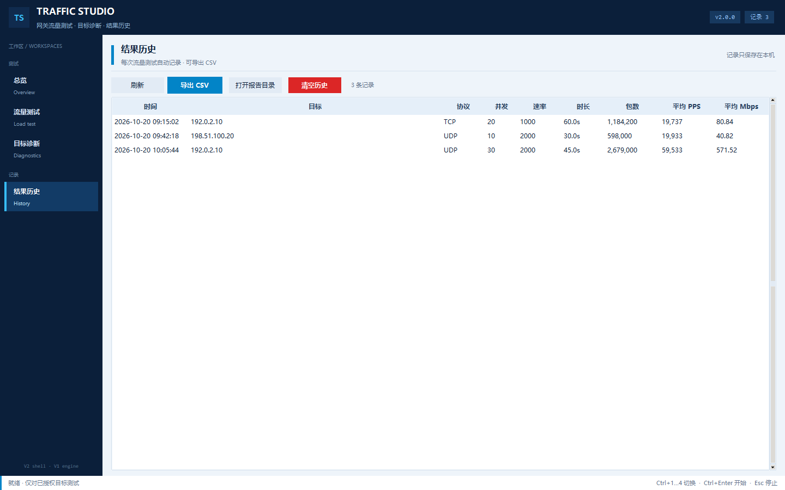

<div align="center">


# 网关流量测试工作台

**面向网络工程师的网关压力测试与目标诊断工作台 —— 先诊断，再压测，结果留档**<br/>
<sub>TCP / UDP / TCP SYN · 实时 PPS 与 Mbps · ICMP/DNS/TCP 诊断 · 测试场景 · 结果历史</sub>

<sub>[**English**](README.md) · [**简体中文**](README.zh-CN.md) · [**使用指南**](docs/USER_GUIDE.zh-CN.md)</sub>

<a href="https://github.com/Yata-Datacom/Traffic-Load-Tester---Gateway-Stress-Tool/actions/workflows/ci.yml"></a>
<a href="https://github.com/Yata-Datacom/Traffic-Load-Tester---Gateway-Stress-Tool/actions/workflows/build.yml"></a>
<a href="pyproject.toml"></a>

<a href="LICENSE"></a>


**v2.0.0** · [CHANGELOG](CHANGELOG.md) · [使用指南](docs/USER_GUIDE.zh-CN.md)

</div>

> ⚠ **仅限授权目标。** 未获得明确授权，不要对公网、客户或第三方系统做压力测试。



---

## ✨ 特点速览

| | |
| :-- | :-- |
| 🧪 | **先诊断** — ICMP 丢包/RTT/抖动、DNS、TCP 端口、默认网关 |
| 🚦 | **三种负载模式** — UDP / TCP / TCP SYN，实时 PPS 与 Mbps |
| 🎬 | **测试场景** — Web、DNS、视频 UDP、SYN 预设，可保存自定义场景 |
| ⏱️ | **持续时间** — 按秒自动停止，或手动停止 |
| 📜 | **结果历史** — 每次完成的测试自动记录，可导出 CSV |
| 🛡️ | **安全默认值** — 默认文档地址，启动前必须确认授权 |
| 🧩 | **运行时零第三方依赖** — 只用 Tkinter 与 socket |

---

## 🆕 2.0 新变化

- 四个工作区：**总览 / 流量测试 / 目标诊断 / 结果历史**
- **目标诊断**：Ping 丢包/RTT/抖动、DNS 解析、TCP 端口探测、默认网关
- **测试场景**：内置 Web / DNS / 视频 UDP / TCP SYN，可保存自定义场景
- **持续时间 + 自动停止**
- **自动结果历史**，支持 CSV 导出
- **中文界面**，技术字段保留英文
- **复用 V1 引擎**：发包、TCP 接收端、端口解析、网关探测不变，降低回归风险

---

## 🚀 快速开始

```bash
python traffic_studio.py
```

或双击 [`traffic_studio.pyw`](traffic_studio.pyw)（无控制台窗口）。
单文件 exe 从 [Releases](https://github.com/Yata-Datacom/Traffic-Load-Tester---Gateway-Stress-Tool/releases) 下载。

V1 旧界面仍保留：

```bash
python traffic_test_gui.py
```

---

## 🎛️ 流量测试

| 参数 | 范围 | 说明 |
| :-- | :-- | :-- |
| 目标 | 任意 | 只填已授权目标 |
| 端口 | `8080` / `80,443` / `100-1000` / `100-1000:50` | 多端口表达式 |
| 协议 | UDP / TCP / TCP SYN | TCP 需要目标监听 |
| 并发 | 1–500 | 线程数 |
| 包大小 | 1–65535 B | 预设 64/256/512/1024/1460 |
| 速率 | 0–50000 pkt/s/线程 | 0 = 不限速，需要确认 |
| 持续时间 | 0–86400 秒 | 0 = 手动停止 |

### 协议模式

| 模式 | 需要目标监听 | 说明 |
| :-- | :-- | :-- |
| UDP | 否 | 直接发数据报 |
| TCP | 是 | 建立完整连接后发送 |
| TCP SYN | 否 | 非阻塞半开连接 |

### 内置接收端

本机 TCP 环回验证：先启动接收端，再对 `127.0.0.1` 的同一端口发起测试。

---

## 🩺 目标诊断

| 检查 | 输出 |
| :-- | :-- |
| ICMP Ping | 丢包率、RTT 最小/平均/最大、抖动 |
| DNS | 解析出的 A/AAAA 地址 |
| TCP 端口 | 通/不通 + 连接耗时（最多 50 个） |
| 默认网关 | 下一跳 + 网卡别名 |



---

## 🎬 测试场景

| 场景 | 协议 | 端口 | 包大小 | 速率 | 并发 |
| :-- | :-- | :-- | :-- | :-- | :-- |
| 网关 Web 压测 | TCP | 80,443 | 512 | 1000 | 20 |
| DNS 53 压测 | UDP | 53 | 256 | 2000 | 10 |
| 视频 UDP 大包 | UDP | 5000 | 1200 | 2000 | 30 |
| TCP SYN 握手 | TCP SYN | 80,443 | 64 | 2000 | 50 |

调整当前参数后可保存为自定义场景，保存在本机 `scenarios.json`（已忽略）。

---

## 📜 结果历史

每次完成的测试追加到本机 `runs.json`：

- 目标、端口、协议、并发、包大小、速率、时长
- 总包数/字节、平均 PPS/Mbps
- 历史页支持刷新、导出 CSV 到 `reports/`、打开目录、清空



---

## 🏗️ 架构

```text
TrafficStudio (Tkinter 工作区外壳)
  ├── 总览 / 流量测试 / 目标诊断 / 结果历史
  ├── traffic_diag.py      ICMP / DNS / TCP / 记录 / CSV
  └── traffic_test_gui.py  V1 引擎：TrafficGenerator / TCPServer / Stats
```

---

## 🧪 开发与测试

```bash
python -m pytest -q
python -m ruff check .
```

**55 项 pytest**：端口解析、Stats 并发、负载生成、Ping 解析、记录/CSV、
旧入口一致性、V2 工作区冒烟。

---

## 🔐 隐私

- `runs.json`、`scenarios.json`、`reports/`、`build/`、`dist/`、`*.exe` 均已忽略
- 截图与文档使用 RFC 5737 地址（`192.0.2.0/24`、`198.51.100.0/24`）与合成数据
- 不要提交真实目标、测试结果、抓包或客户拓扑

---

MIT License · © 2026 Yata-Datacom · Traffic Studio
